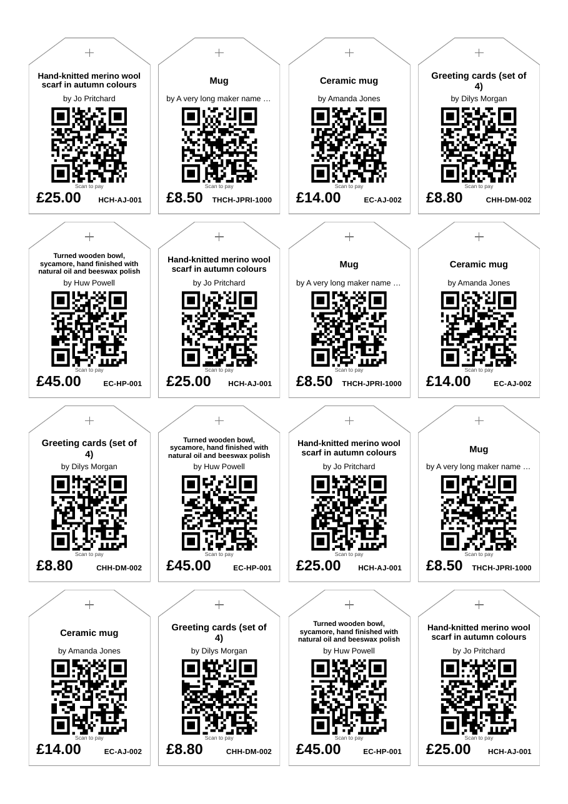

# Google Sheet → Square links → printed tags

Type your products into a Google Sheet. One menu command creates a Square payment link for every new row, and another prints tags showing the **QR code, product description, maker name, price and item code**. The tags print on A4 card, and you cut them out and tie them on with ribbon.




Files (in [`google-sheet/`](../google-sheet/)):

| File | What it is |
|---|---|
| `Code.gs` | Adds the **Craft Hereford** menu; talks to Square |
| `Labels.html` | The tag preview and print window |

## How it fits together

```
Makers tab + Locations tab (dropdown lists)
   └─ Products tab row (description, maker, location, price, commissions)
        └─ Craft Hereford ▸ Create Square links  →  link URL + item code written back to the row
        └─ Craft Hereford ▸ Print tags       →  16 tapered tags per A4 sheet (QR + text), ready to print on card
```

The Square access token is kept in the script's private properties, not in any cell. The QR code is drawn inside your browser from the link; nothing is sent to a QR website.

## One-off setup (about 20 minutes)

### 1. Square account and API keys

1. Create a Square account at [squareup.com/gb](https://squareup.com/gb) and finish verification and bank details.
2. Go to the [Square Developer Dashboard](https://developer.squareup.com/apps), sign in, and **create an application** (name it e.g. "Craft Hereford sheet").
3. Open the app and note, for **Sandbox** first:
   - the **Sandbox access token** (Credentials tab). You don't need the Application ID or the Location ID: the sheet finds your location itself.
4. Later, for real payments, repeat with **Production**: the Production access token.

Start in sandbox: links work with Square's test cards and no real money moves.

### 2. Create the Google Sheet

1. Make a new Google Sheet.
2. **Extensions → Apps Script**. Delete the sample code and paste in the contents of `Code.gs`.
3. Click **+ → HTML**, name it exactly `Labels`, and paste in the contents of `Labels.html`.
4. **Save**, close the Apps Script tab, and **reload the Sheet**. A **Craft Hereford** menu appears.
5. **Craft Hereford → Set up sheet (first time)**. This builds the four tabs (Products, Makers, Locations, Settings), the dropdowns and the commission formulas. Google asks you to authorise the script; this is normal, as it's your own script. If you see "Google hasn't verified this app", choose **Advanced → Go to … (unsafe)**.
6. **Craft Hereford → Connect to Square…** and enter `sandbox`, then the sandbox access token. The sheet checks the token with Square and finds your location (if there are several it asks which). If the location doesn't take GBP payments it warns you.

> Anyone with **edit** access to the Sheet can open the script and read the token. Share edit access only with volunteers you trust; give everyone else "view" or "comment".

## Everyday use

### The four tabs

| Tab | What goes in it |
|---|---|
| **Makers** | One row per maker: name, **code**, email, phone, address. These names fill the **Maker** dropdown on Products. The code fills itself in from the name (Amanda Jones → `AJ`); type over it to choose your own. |
| **Locations** | One row per venue: name, **venue commission %**, **code**, email, phone, address. The code fills itself in like a maker's (Hereford Coffee House → `HCH`). These names fill the **Location** dropdown. A new location gets the default venue commission from Settings (10%); change it on its own row if that venue agreed something different. |
| **Settings** | The default venue commission (10%), the default selling commission (10%), and the list of selling-commission rates offered in the dropdown (0%, 5%, 10%, 15%, 20%, 25%, 30%). Edit the list to add rates such as 12.5%. |
| **Products** | One row per item (see below). |

Add makers and locations first, and delete the example row on each tab. Keep names unique and spelled the way you want them to appear on the tags. If you rename a maker or location, re-pick it on the Products rows that used it.

### Add products
On the **Products** tab fill in **Product description**, **Maker** (dropdown), **Location** (dropdown) and **Price (GBP)**. Leave Item code, link and Status for the script (the item code is made for you, see below). Keep descriptions short (about 40 characters or fewer); long ones are printed in a smaller font.

The commission columns work like this:

- **Venue commission %** (grey) is looked up from the Locations tab, so you don't type it.
- **Selling commission %** is filled with your default (10%) as soon as you type a description. Pick another rate from the dropdown for any item. This is the share that goes to Craft Hereford to cover Square's fees and the running of the platform.
- **Venue commission (GBP)**, **Craft Hereford commission (GBP)** and **Maker receives (GBP)** are calculated, on the item price. Maker receives = price − venue − Craft Hereford, and the two commissions are rounded to the penny.

Example: a £25.00 scarf in a café on 10% venue commission and 10% selling commission gives £2.50 to the venue, £2.50 to Craft Hereford and £20.00 to the maker.

When you set an item's **Status** to *Sold*, its venue commission % is frozen, so changing a location's rate later doesn't alter past sales. (Setting the status back to Draft or Listed restores the lookup.)

### Item codes

Each item's code is made automatically as soon as you have picked both its **Maker** and its **Location**:

```
HCH-AJ-001
 │   │   └─ number, counting up for that location + maker (001, 002, …)
 │   └───── maker's code (Amanda Jones)
 └───────── location's code (Hereford Coffee House)
```

- The code is saved as fixed text. It doesn't change if you sort or delete rows, or later change the maker or location of that row, so a printed tag always matches the sheet and the Square payment.
- The code appears in the Square payment link name and on the printed tag, so a customer, a café or you can quote it.
- Two makers (or two locations) can end up with the same code, for example Amanda Jones and Alan Jenkins are both `AJ`. These cells turn red. Type a different code over the formula (`AMJ`) **before** adding their items.
- This needs the script installed (see setup). Without it, the Item code column stays empty and you'd type codes yourself.

### Create links
**Craft Hereford → 1. Create Square links for new rows**.
Each row without a link gets one, and the script writes back the link URL, and sets Status to *Listed*. Rows with a problem (no price, maker, location or commission rate) are skipped and listed in the message. Items already marked *Sold* never get a link, and rows that already have one are left alone.

### Print tags
1. Optional: select the rows you want (select two or more rows). With no selection, every row with Status *Listed* is printed.
2. **Craft Hereford → 2. Print tags…**
3. You see a preview of A4 sheets. The default tag is **45 × 65 mm**, which fits **16 per A4 sheet** (4 across, 4 down). Change the width or height if you like, and set **Copies of each** for duplicates. Open **More options** to change the depth of the tapered end, the width of the tip, the gaps, or to switch the cut outline and hole marker off. Your settings are remembered.
4. Click **Print**. In the print window choose **A4**, **Margins: None**, **Scale: 100%** (not "fit to page"), and switch **Headers and footers** off. Load your card and print.
5. **Cut along the grey outline** and **punch the ribbon hole at the +** (the + sits in the middle of the tapered end, about 5 mm from the top edge, so a standard 6 mm punch fits).

Each tag shows the description, the maker, the QR code, the price and the item code. If a description is too long it is shrunk to fit; keep descriptions to about 40 characters. If the QR code would end up smaller than about 20 mm, the preview shows a warning in red: make the tag taller or the description shorter.

**Do a test print of one sheet on plain paper first**, hold a printed tag against your actual card and punch, and scan it with a phone before printing a whole batch. A good scan is the real check that the QR code works.

### When an item sells: sync from Square
Run **Craft Hereford ▸ 3. Sync sales from Square** (as often as you like; once a day or before a report is plenty). It reads your recent Square payments and, for each completed payment:
- finds the item by the code in the payment note (or the order's item name);
- sets its **Status** to *Sold*, its **Sold date** to the payment date, and freezes the venue commission rate;
- records the **Square payment ID** and the **Square fee** on the row;
- switches off that item's Square link, so nobody can pay for it twice.

It is safe to run repeatedly: items already synced are left alone. The first run looks back 90 days; later runs look back from the last sync (with a day of overlap). Reconnecting to Square starts a fresh history.

Things it flags instead of guessing (also written to the **Sync note** column on the row, and shown in the pop-up):
- **Paid twice:** a second, different payment for an item already paid for.
- **Refunded:** the payment was refunded in Square. The sheet does not change the sale; decide whether to reset the status and don't pay the maker until it's sorted.
- **Price mismatch:** the amount paid differs from the price on the sheet.
- **Date gap:** the item had been marked *Sold* by hand on a different date from the payment.
- **Not matched:** payments with no item code (for example sales taken in person on Square) or a code that isn't on the Products tab. These are listed in the pop-up and left alone.

You can still mark items *Sold* by hand (for example a cash sale). **4. Switch off links for sold items** switches off the links of any *Sold* item that still has one.

The Monthly report adds **Square fees on synced sales** and **Craft Hereford commission after Square fees**, so you can see whether the selling commission covers the fees. Fees are only known for items that have been synced.

**If the sync finds nothing or something looks wrong,** run **Craft Hereford ▸ Check Square connection**. It lists what Square can see for your token: the location in use, how many payment links and orders exist, and how many payments there are at each location. A payment that exists under a different location, or an order with no payment, shows up straight away.

**Cross-check:** a month's sales in Square's own reports should equal Total sales on the Monthly report (before fees), provided every sale was a sheet link and has been synced.

## The payment page: logo, colours and Apple Pay

The page a customer sees after scanning is Square's own hosted checkout, so what you can change is limited to the settings below.

**Logo and button colour (in Square, no code):**
1. In the Square Dashboard go to **Payment Links ▸ Settings ▸ Branding** (Square's guide: [Customize Square payment links](https://squareup.com/help/article/8364-customize-square-payment-links)).
2. Turn on the **Logo** and upload one of the ready-made files from `logo-pack/08-square-checkout/`. They are exactly 1280 × 680 px, the size Square recommends:
   - `square-checkout-logo-badge-1280x680.png`: the round badge centred.
   - `square-checkout-logo-horizontal-1280x680.png`: icon and name side by side.
3. Choose a **buy button colour**. Use the deep blue `#2F5568`: white text on it is easy to read (about 8:1 contrast), whereas on the paler Craft blue `#6894AE` it is only about 3:1.

Menu names can change; if a screen looks different, search Square's help for "Payment Links branding". Settings may be per location and per environment, so set them in the **live** Square account as well as in sandbox.

**Apple Pay and Google Pay:** the script asks Square to offer both on every link it creates (`ACCEPT_WALLETS` at the top of `Code.gs`; set it to `false` to turn that off). Things to know:
- They only appear on devices and browsers that support them: Apple Pay in Safari on an iPhone, iPad or Mac, Google Pay in Chrome on Android.
- Square's developer forums have reports of Apple Pay **not appearing on links made through the API** even with the setting on, while Google Pay does appear, and Apple Pay appearing on links made by hand in the Dashboard. I can't confirm whether that affects your account, so please test it on a real iPhone with a **live** link and a small payment (refund it afterwards). I don't believe Apple Pay can be tested in sandbox.
- If Square refuses the setting, the script still creates the link (without wallets) and tells you in the pop-up.

## Reports and payments

The report tabs are formulas, so they update by themselves; nothing needs the script.

### Recording sales and payments
- An item counts as sold when its **Status** is *Sold*. Its **Sold date** (stamped automatically, editable) decides which month it appears in.
- When you pay a maker, tick **Maker paid?** on the Products tab. When you pay a venue its commission, tick **Venue paid?**. Both are tick boxes at the right-hand end of the row.

### Monthly report
Choose a month from the **Month** dropdown (the last 36 months are listed). You get:
- **Craft Hereford totals:** items sold, total sales, venue commission, Craft Hereford commission and the amount paid or payable to makers. A "Difference" line should read £0.00; if it doesn't, some sold item is missing a maker, location or commission.
- **By maker:** items, sales, venue commission, Craft Hereford commission and what the maker receives.
- **By venue:** items, sales and the venue's commission.

The two tables list up to 100 makers and 100 venues.

### Statements
One statement is shown at a time, for either a maker or a venue, never both:
1. **Statement for:** choose *Maker* or *Venue*.
2. **Name:** choose from the list (it switches to match the type; if the name doesn't match the type you'll see a prompt and the statement stays empty).
3. **Month:** choose a month.

You get the totals for the month and every item sold, in date order, with a Paid? column. A maker's statement shows what the maker receives; a venue's shows the venue commission.

### Outstanding payments
Also one at a time: choose *Maker* or *Venue*, then a name. It shows the amount Craft Hereford still owes them, how many items that covers, their email, phone and address, and each unpaid item.

For an overview of everyone owed, use the **Outstanding (GBP)** and **Payment due?** columns on the **Makers** and **Locations** tabs (highlighted amber when *Yes*), or the **Unpaid items** tab, which lists every sold item where the maker or the venue is still unpaid. Tick Maker paid? / Venue paid? on the Products tab to clear an item.

Amounts owed are based on sold items only, from the first sale ever, not just one month.

The **Lists** tab holds the calculated lists behind the dropdowns. There is nothing to edit there.

> **Setting up a second copy:** *Craft Hereford ▸ Set up sheet* builds the Products, Makers, Locations and Settings tabs, but not the four report tabs. To start another copy with everything, use **File ▸ Make a copy** on the finished sheet, then clear the product rows.

## Printing on A4 card: tips

- **Use your normal printer** and choose a paper type such as "card" or "thick paper" if it has one. Check that your printer takes the card weight you've chosen.
- **Always print at 100%.** "Fit to page" or "shrink to fit" changes the tag size and the cut lines will no longer match your 45 × 65 mm tags.
- **Tags print on one side only.** The back is left blank.
- **Cutting:** a guillotine or craft knife and ruler along the grey outline works for the straight edges; use scissors for the tapered corners. The outline is light grey so it is barely visible once cut just inside it. Switch it off in **More options** if you'd rather cut by eye.
- **The + marks the hole position** and sits where the hole is punched out, so it disappears. Switch it off in **More options** if you prefer.
- **QR code size:** keep it at least 20 mm on its side. The default tag gives about 27 mm.
- Printing from **Chrome** is the most reliable.

## Going live

When your sandbox test works end to end: run **Connect to Square…** again, enter `live` and the Production access token, and create links for your real products. Links made in sandbox won't work in the live account, so delete the test rows first.

## Things to check

I tested the label page and helper functions in a sandbox environment, but not against Square's servers or inside Google Sheets, since I have no accounts for either. During your sandbox test, check that:

- link creation works for a UK account (Square's Payment Links API availability and the `GBP` currency); if it errors, the message appears in the pop-up.
- the checkout page shows the item name, price and your maker/code details.
- the **Selling commission %** dropdown shows the percentages and, when you pick one, stores the right number (e.g. 15% stays 0.15).
- the Maker and Location dropdowns list what's on the Makers and Locations tabs, and a new name appears straight away.
- the default selling commission fills in when you type a description (this runs when you type or paste in the editor, but not for rows added by an import or another script, so check those).
- the Square API version in `Code.gs` (`SQUARE_VERSION`) is still supported; Square's [API docs](https://developer.squareup.com/reference/square/checkout-api/create-payment-link) list current versions.

If the API route proves awkward, you can still paste links in by hand: create each link in the Square Dashboard ([guide](square-qr-codes.md)), paste the URL into **Square link URL**, set Status to *Listed*, and use the print step as normal.
