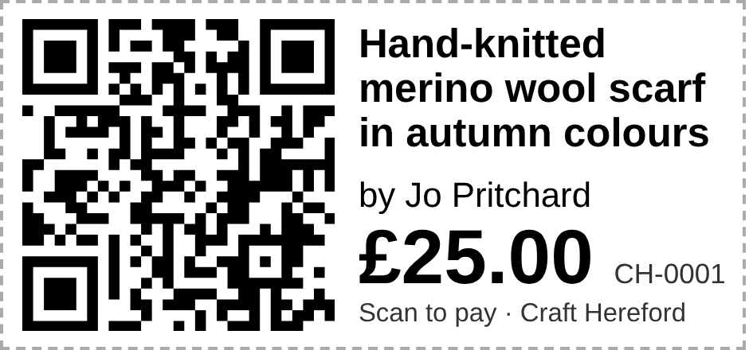

# Google Sheet → Square links → label printer

Type your products into a Google Sheet. One menu command creates a Square payment link for every new row, and another prints labels showing the **QR code, product description, maker name and price**.



Files (in [`google-sheet/`](../google-sheet/)):

| File | What it is |
|---|---|
| `Code.gs` | Adds the **Craft Hereford** menu; talks to Square |
| `Labels.html` | The label preview/print window |

## How it fits together

```
Makers tab + Locations tab (dropdown lists)
   └─ Products tab row (description, maker, location, price, commissions)
        └─ Craft Hereford ▸ Create Square links  →  link URL + item code written back to the row
        └─ Craft Hereford ▸ Print labels     →  QR + text, one label per page, sized for your printer
```

The Square access token is kept in the script's private properties, not in any cell. The QR code is drawn inside your browser from the link; nothing is sent to a QR website.

## One-off setup (about 20 minutes)

### 1. Square account and API keys

1. Create a Square account at [squareup.com/gb](https://squareup.com/gb) and finish verification and bank details.
2. Go to the [Square Developer Dashboard](https://developer.squareup.com/apps), sign in, and **create an application** (name it e.g. "Craft Hereford sheet").
3. Open the app and note, for **Sandbox** first:
   - the **Sandbox access token** (Credentials tab), and
   - the **Location ID** (Locations tab, make sure *Sandbox* is selected).
4. Later, for real payments, repeat with **Production**: the Production access token and your real Location ID.

Start in sandbox: links work with Square's test cards and no real money moves.

### 2. Create the Google Sheet

1. Make a new Google Sheet.
2. **Extensions → Apps Script**. Delete the sample code and paste in the contents of `Code.gs`.
3. Click **+ → HTML**, name it exactly `Labels`, and paste in the contents of `Labels.html`.
4. **Save**, close the Apps Script tab, and **reload the Sheet**. A **Craft Hereford** menu appears.
5. **Craft Hereford → Set up sheet (first time)**. This builds the four tabs (Products, Makers, Locations, Settings), the dropdowns and the commission formulas. Google asks you to authorise the script; this is normal, as it's your own script. If you see "Google hasn't verified this app", choose **Advanced → Go to … (unsafe)**.
6. **Craft Hereford → Connect to Square…** and enter `sandbox`, the sandbox access token, then the location ID.

> Anyone with **edit** access to the Sheet can open the script and read the token. Share edit access only with volunteers you trust; give everyone else "view" or "comment".

## Everyday use

### The four tabs

| Tab | What goes in it |
|---|---|
| **Makers** | One row per maker: name, email, phone, address. These names fill the **Maker** dropdown on Products. |
| **Locations** | One row per venue: name, **venue commission %**, email, phone, address. These names fill the **Location** dropdown. A new location gets the default venue commission from Settings (10%); change it on its own row if that venue agreed something different. |
| **Settings** | The default venue commission (10%), the default selling commission (10%), and the list of selling-commission rates offered in the dropdown (0%, 5%, 10%, 15%, 20%, 25%, 30%). Edit the list to add rates such as 12.5%. |
| **Products** | One row per item (see below). |

Add makers and locations first, and delete the example row on each tab. Keep names unique and spelled the way you want them to appear on labels. If you rename a maker or location, re-pick it on the Products rows that used it.

### Add products
On the **Products** tab fill in **Product description**, **Maker** (dropdown), **Location** (dropdown) and **Price (GBP)**. Leave Item code, link and Status for the script. Keep descriptions short (about 40 characters or fewer); long ones are printed in a smaller font.

The commission columns work like this:

- **Venue commission %** (grey) is looked up from the Locations tab, so you don't type it.
- **Selling commission %** is filled with your default (10%) as soon as you type a description. Pick another rate from the dropdown for any item. This is the share that goes to Craft Hereford to cover Square's fees and the running of the platform.
- **Venue commission (GBP)**, **Craft Hereford commission (GBP)** and **Maker receives (GBP)** are calculated, on the item price. Maker receives = price − venue − Craft Hereford, and the two commissions are rounded to the penny.

Example: a £25.00 scarf in a café on 10% venue commission and 10% selling commission gives £2.50 to the venue, £2.50 to Craft Hereford and £20.00 to the maker.

When you set an item's **Status** to *Sold*, its venue commission % is frozen, so changing a location's rate later doesn't alter past sales. (Setting the status back to Draft or Listed restores the lookup.)

### Create links
**Craft Hereford → 1. Create Square links for new rows**.
Each row without a link gets one, and the script writes back the item code (`CH-0001`, `CH-0002`, …), the link URL, and sets Status to *Listed*. Rows with a problem (no price, maker, location or commission rate) are skipped and listed in the message.

### Print labels
1. Optional: select the rows you want (select two or more rows). With no selection, every row with Status *Listed* is printed.
2. **Craft Hereford → 2. Print labels…**
3. Set your **label width and height in mm** and the number of copies, then **Print**. The size is remembered.
4. In the browser print window: choose your **label printer**, set the paper size to match your label, **margins: None**, **scale: 100%**.

**Do a test print of one label and scan it with a phone before printing a whole batch.** A good scan on a printed label is the real check that the QR code works.

### When an item sells
Set **Status** to *Sold* (this also stamps the sold date) and run **3. Switch off links for sold items**. This deletes the Square link, so a second person scanning an old label cannot pay for an item that is gone. Then take the label out of the cabinet.

## Label printer tips

- Common sizes: Brother DK-11209 is 62 × 29 mm (the default here); Dymo 99010 is 89 × 28 mm. Check the box your labels came in.
- Install your printer's **driver** and add the matching **paper size** (custom or its label size) in the print dialog. A label printer will otherwise treat the page as A4.
- If your print dialog scales or rotates the label, try changing orientation or choosing the printer's "no margins" option.
- Keep the QR code above about 20 mm on its side. The default layout gives about 26 mm on a 29 mm label.
- Printing from **Chrome** is the most reliable.

## Going live

When your sandbox test works end to end: run **Connect to Square…** again, enter `live`, the Production access token and your real Location ID, and create links for your real products. Links made in sandbox won't work in the live account, so delete the test rows first.

## Things to check

I tested the label page and helper functions in a sandbox environment, but not against Square's servers or inside Google Sheets, since I have no accounts for either. During your sandbox test, check that:

- link creation works for a UK account (Square's Payment Links API availability and the `GBP` currency); if it errors, the message appears in the pop-up.
- the checkout page shows the item name, price and your maker/code details.
- the **Selling commission %** dropdown shows the percentages and, when you pick one, stores the right number (e.g. 15% stays 0.15).
- the Maker and Location dropdowns list what's on the Makers and Locations tabs, and a new name appears straight away.
- the default selling commission fills in when you type a description (this runs when you type or paste in the editor, but not for rows added by an import or another script, so check those).
- the Square API version in `Code.gs` (`SQUARE_VERSION`) is still supported; Square's [API docs](https://developer.squareup.com/reference/square/checkout-api/create-payment-link) list current versions.

If the API route proves awkward, you can still paste links in by hand: create each link in the Square Dashboard ([guide](square-qr-codes.md)), paste the URL into **Square link URL**, set Status to *Listed*, and use the print step as normal.
